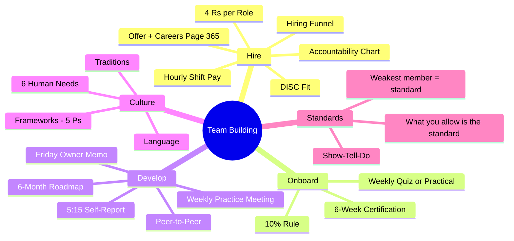

# Team Building — Map of Content

> **Core idea:** Run the gym team like a sports team. Draft for the position, practice every week, coach to a standard. Athletes thrive with *practice*; they freeze under *evaluation*.

## The journey
1. [[01 Hiring - Accountability Chart and 4 Rs]]
2. [[02 Hiring - Pay and Offer]]
3. [[03 Hiring - Funnel and Interview]]
4. [[04 Onboarding - Certification Model]]
5. [[05 Development - Weekly Rhythm Tools]]
6. [[06 Culture - Language Frameworks Traditions]]
7. [[07 Standards]]
8. [[08 Templates and Checklists]]

## Final thoughts
- Once marketing is solved, **team becomes the #1 problem** — biggest asset *and* biggest headache.
- **Always be recruiting** — build your bench even when full.
- Culture is like a baby: **you constantly have to feed it.** Never "done."

## Quick-start (this week)
- [ ] Write the 4 Rs for the Coach role → [[08 Templates and Checklists#4 Rs Template]]
- [ ] Build the 5:15 Google Form, first submission Friday
- [ ] Turn next staff meeting into practice reps on one exercise

## Related (separate segment)
- [[Sales Consult - Connect Discover Evaluate Prescribe Close]]
