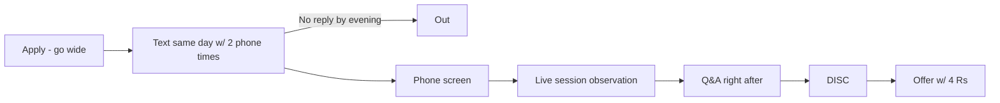

# Hiring — Funnel & Interview
Back to [[00 Team Building MOC]]

## Follow-up = first test
- Let **everyone** apply. Text immediately: *"Thanks for applying — I have [A] or [B] for a phone interview, which works?"*
- Slow/no reply (applied 2pm, no answer by 5–6pm) → **not a fit**. Strong correlation between process communication and employee quality.
- Late to the phone call → will be late to sessions.
- Typical math: 10 apps → ~5 phone screens → ~2 in person.

## Phone screen
- Skip resume questions. Ask: **"Why do you want this job?"** and **"What's your story?"**
- Industry is a grind — need a **deeper why** than a paycheck.
- Confirm **logistics**: schedule (Doug: M–F 5:30a–1p, 40 hrs, non-negotiable), location/commute.

## In-person
- Bring them in **during a live session** (not an empty gym) — ideally one you're not coaching.
- **Immediate Q&A** afterward — no "we'll call you."
- Prefer observation over "coach us" (intimidating, doesn't show real coaching).

## DISC — hire for team gaps, not clones
| Letter | Profile | Fits |
|---|---|---|
| **D** | Driver, wants control, dislikes rules | Owners; hard-to-manage coaches |
| **I** | People person, extroverted, fun | Energy/fun coach |
| **S** | Loyal, steady | Long-tenure team member |
| **C** | Detail, checklists, order | Admin |
- Example: technical-but-dry coach #1 → prioritize **fun** in coach #2. (Left tackle vs. wide receiver.)

Next → [[04 Onboarding - Certification Model]]
